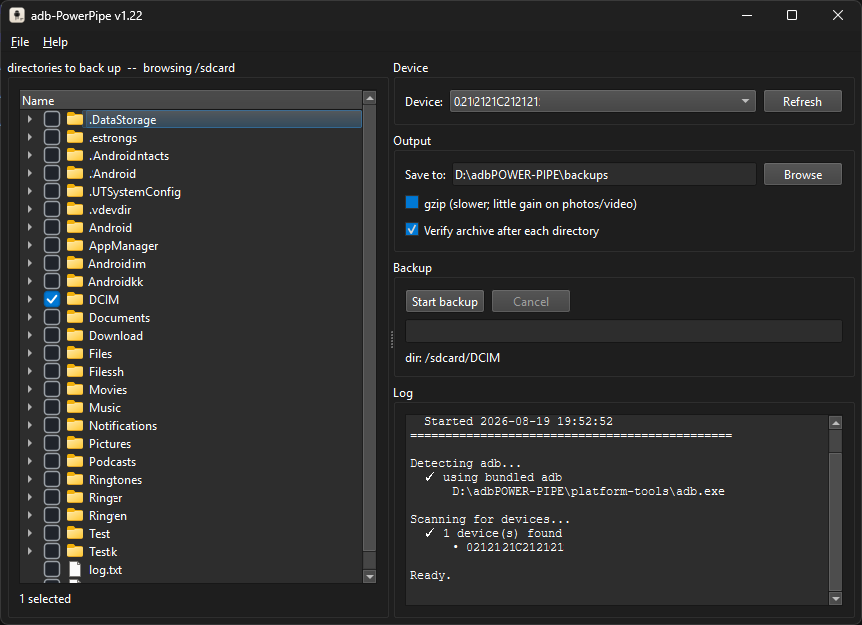
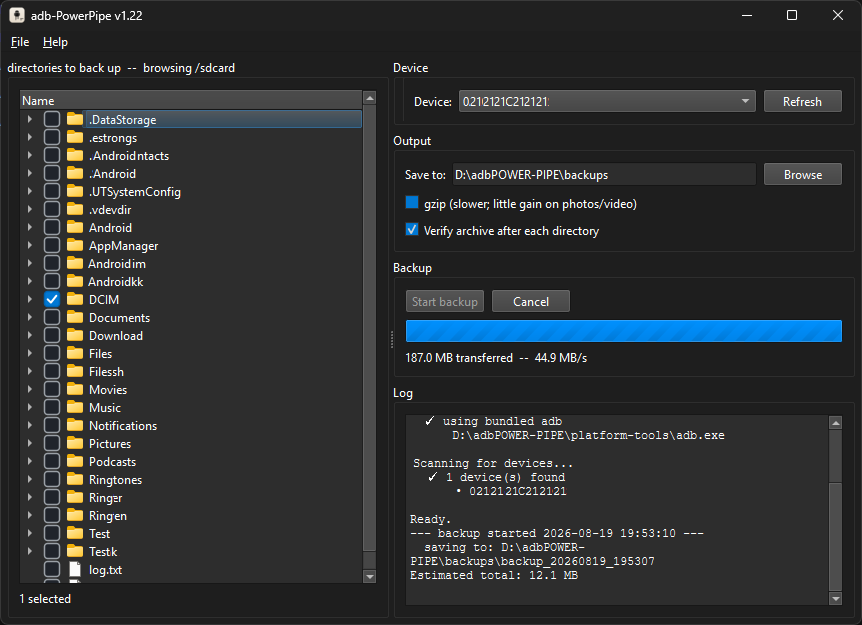

# adb-PowerPipe: BACKUP

Backup android devices quickly and easily by using `adb-exec` and tar streams.

<p align="center">
  <a href="screenshot-01.png"></a>
  &nbsp;
  <a href="screenshot-02.png"></a>
</p>

### [⬇ Download adb-PowerPipe v1.26 (Windows .exe)](https://raw.githubusercontent.com/honeybugserial/abd-PowerPipeBackup/refs/heads/main/adb-PowerPipe_v1_26.exe)

## Settings/Operations

- Tar & gzip compression (`.tar.gz`). Default: tar (Better for files like photos)
- Archive verification
- Each backup saved to a timestamped directory (`backup_<datetime>`).
- System path adb used by default if found
- Latest platform-tools direct download from script if needed.
- ScriptDirectory\platform-tools\adb.exe will take priority over system path adb.
- Settings saved in `config.toml`

## Requirements

- Python 3.11+
- PySide6
- Android platform-tools (`adb`)

```
pip install PySide6
pip install tomli
```

## Usage

```
python adb-PowerPipe_v1_21.py
```

1. Connect device with USB debugging turned on
2. Select directories to be backed up.
3. Choose output directory, or use the default `backups` directory.
4. ???
5. Click Start.

Default save location:

```
ScriptDirectory/backup_<datetime>/<device-directory-name>.tar/tar.gz
```

## Configuration

`config.toml` created on first launch, delete to reset.

```toml
[backup]
output_dir = ""      # backup save location
compress = false     # gzip the archive. Off best for photos and video.
verify = true        # re-open each archive afterward and count entries.
chunk_mib = 1        # read size

[folders]
root = "/sdcard"     # file tree TLD

[ui]
theme = "Fusion"     # Qt style
```
